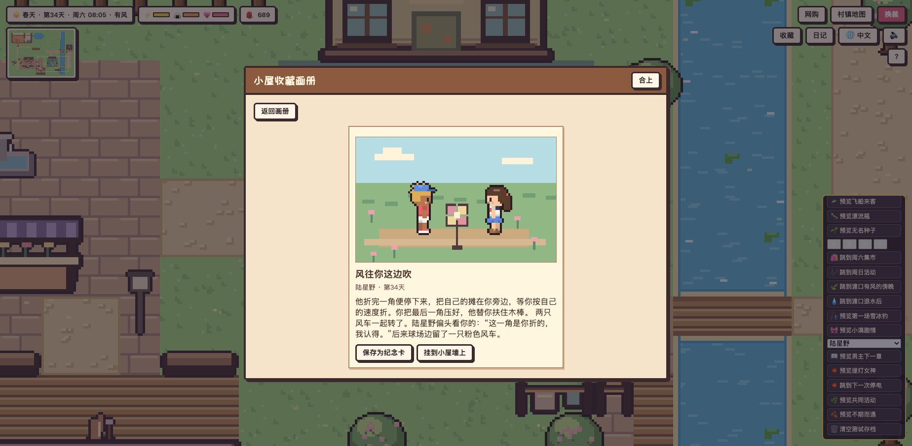

# 像素小屋 · Pixel Cottage · ピクセル小屋

一个像素风的「过日子 + 换装 + 恋爱」小游戏。游戏通过网页入口加载玩法模块和三种语言文本，游戏内像素画面与音效由代码生成。

A cozy pixel-art life sim with dress-up and romance, playable in 中文 / English / 日本語. Every sprite is drawn by code; there are no image or audio files.

**▶ 在线试玩 · Play online · オンラインで遊ぶ：<https://aubreykuang.github.io/HomeLove/>**

🛠 测试模式（金手指、数值拉满）· Test mode · テストモード：<https://aubreykuang.github.io/HomeLove/dev.html>

[中文](#中文) · [English](#english) · [日本語](#日本語) · [项目结构 / Project layout](#项目结构--project-layout)


## 截图 · Screenshots

| | |
|---|---|
|  |  |
| 约会和对话选项（English）<br>Dates and dialogue choices | 深夜和恋人白夜看星星（日本語）<br>Late night with Bai Ye |
|  |  |
| 衣柜，♥ 表示有人喜欢（中文）<br>The wardrobe; ♥ marks what someone likes | 日记里的关系和攻略笔记（English）<br>The diary: affection and notes |
|  |  |
| 金手指：所有男生好感全满，全都跑来找你（中文）<br>The Golden Charm brings every guy running | 在领养站领养宠物（日本語）<br>Adopting a pet at the hut |
|  |  |
| 修罗场：恋人吃醋了（中文）<br>Jealousy: caught by your partner | 同居生活：恋人在厨房做早饭（English）<br>Living together: breakfast in the new kitchen |


---

## 中文

### 游戏简介

你住在一间小屋里，屋外有池塘、菜园和花园。每天要吃饭、睡觉、换衣服，一天里会有五位居民轮流来院子里串门。和他们聊天、送礼物、一起做事、约会，好感够了就能告白，最后还能邀请对方搬进小屋一起住。

### 主要玩法

- **过日子**：时间会流逝（现实 1 秒 = 游戏 2 分钟），有白天、傍晚和夜晚。三条状态要照顾：⚡精力（去小床睡觉）、🍙饱腹（去小圆桌吃饭）、💗心情。熬到凌晨 2 点或精力耗光会直接睡着。
- **换装**：7 类衣物（肤色、发型、上衣、下装、鞋子、头饰、配饰），大部分有 12 种颜色，可以转身查看四个方向，可以随机搭配，最多收藏 6 套。在院子里采 3 朵花能解锁花环。
- **扭蛋机**：门口信箱右边按 E，选 **连衣裙与礼服**（18 款）、**发型**（10 款）、**上衣**（8 款）或 **半裙**（5 款）。四池共用一次免费首抽，之后每抽用 2 枚贝壳或 3 朵花，池内不重复。抽中后可以当场试穿，或者打开衣柜改色、混搭、保存搭配。抽中礼裙或半裙时，第三个选项「再来一抽」会直接打开本池的付款菜单。
- **居民专属故事**：顾言、陆星野、江屿和白夜各有三章。见面时从对话菜单进入，章节按好感与日期解锁，选项和回忆会留在收藏画册。
- **收集和制作**：在花园采花，在小圆桌用草莓烤饼干，在书桌写情书。菜园和池塘的收成也可以在灶台做饭，或者作为礼物送给居民。
- **种田**：到院子右侧菜地按 E 播种或照料。胡萝卜、草莓和南瓜分别需要 1、2、3 个浇过水的夜晚。草莓收过后，再浇水过一晚还能结果。一天没浇水，作物会等着你。种得多时可以一次浇完所有缺水的菜地。
- **钓鱼**：面朝池塘按 E 选钓法。西侧芦苇边常见小鱼，东侧开阔水面更容易钓到金鳞鲤或月光鱼。白天找金鳞鲤，天黑再来找月光鱼。草莓鱼饵能缩短等待、延长收竿时间，也更容易钓到这两种鱼。看到「！」后趁进度条走完前收竿，鱼的首次钓获日期和最长尺寸会记进日记。
- **月下同钓**：第一次送白夜月光鱼后，过两天晚上 19:00–23:30 到院子里。他会走过来邀请你去池塘。可以改天再去，鱼跑了也可以再抛一竿。一起钓到的第一条鱼会留下像素纪念卡，写着时间、鱼名和尺寸，白夜后来还可能在聊天时提起它。
- **邻里来信**：认识居民后，门口信箱会出现带像素信封标记的委托。接下后去日记看期限，再找写信的人交付两种备选物品中的任意一种。交付会获得花或贝壳与 6 点好感。每位居民的第一次委托会留下纪念卡，日后聊天也可能提起你带过的东西。来信保留三天，跳过或过期不扣好感。
- **恋爱和攻略**：
  - 每天可以和每个人聊天（有问答）、互动（夸奖、开玩笑、撩一下、牵手、拥抱、亲亲）、送礼物、一起做事（散步、钓鱼、看书、运动、看星星），以及约会（池塘、花园、星空野餐、在家做饭）。
  - 每个人吃的那一套都不一样：喜欢的颜色、衣服、礼物、话题、活动和约会地点各不相同。穿上对方喜欢的风格再去聊天，好感涨得更多。
  - 试过的东西会记进日记的「攻略笔记」，用 😍😊🙂😐😣 表示对方的反应。
  - 好感进度：2♥ 解锁一起做事，4♥ 撩一下，6♥ 约会，7♥ 牵手，8♥ 告白（心情至少 40，且和对方完成过一次约会或专属共同活动），恋人 9♥ 亲亲，10♥ 邀请同居。
  - 池塘约会 45 分钟、逛花园 60 分钟、星空野餐 90 分钟、在家做饭 105 分钟。菜单会标出预计结束时间，方便把约会和浇菜、交委托或其他安排放在同一天。凌晨 2 点前结束不了的约会会标为来不及。
  - 有了恋人还去撩别人、约别人，被恋人看到会吃醋扣好感（见下面的「修罗场」）。
- **四季与冰钓**：每 7 个游戏日换季。秋天树叶转金黄，冬天积雪封住池塘，南岸有两个冰钓口。露地暂停播种和生长，可用贝壳安装小温棚继续种植。
- **小满的暗恋**：从系丝带、池塘边送花，到小满主动告白。女主可以婉拒后保留友情，也可以好好告别。两个选择会改变她之后的来访和来信。
- **随机事件**：深夜池塘可能落下一艘飞船，钓鱼可能拉上一个漂流瓶，小满也可能带来一包无名种子。事件的选择会留下不同的纪念卡和后续对白。
- **收藏画册**：点右上角「收藏」或按 `B`，翻看约会、生日、探病等事件留下的像素纪念卡，也能收下邻居寄来的明信片。见[玩法、测试与截图](#生活回忆玩法测试与截图)。
- **宠物**：小路边的领养站可以领养小猫、小狗、小鸟、小兔（每种 3 种毛色，最多养 3 只），从候选名字里给它取名。宠物会跟着你走，也可以让它在原地等你。每天可以摸摸、喂它爱吃的东西、陪它玩；亲密度高了，早上会叼礼物回来。每位居民也有偏爱的小动物，带着对的宠物去聊天会额外加好感。
- **同居生活**：小屋扩建了，右边多了厨房（冰箱、灶台、台面）和健身角，卧室换成了双人床。好感满 10♥ 邀请恋人搬进来后，TA 会按时间表过日子：早上 7 点和傍晚 5 点半做饭（做好的饭放在小圆桌上，去吃就能回饱腹和心情），上午扫地，下午在健身角锻炼。TA 干活时可以过去帮忙，平时可以依偎在一起；晚上 9 点以后可以「今晚一起睡」，画面淡出，第二天早上会有专属的晨间对白。你自己也可以用灶台做菜、在健身角运动，恋人在家会一起帮忙。
- **金手指**：院子角落藏着一个闪闪发光的道具。用了以后，顾言、陆星野、江屿、白夜的好感度直接满格，当天还会全都跑来找你、跟着你转。捡到后可以马上用，也可以收进背包，之后在日记里点「使用」。
- **音乐和音效**：轻柔的八音盒背景音乐，晚上会变得更慢、更安静；走路、对话、采集、钓鱼、宠物叫声、好感上升都有音效。全部由浏览器现场合成，没有音频文件。按 M 或右上角 🔊 可以静音。

### 同居后的一天

邀请恋人搬进来以后，TA 会自己按时间表过日子，不用你操作。新厨房和健身角在客厅右边，穿过右墙的门洞就到了。

| 时间 | 恋人在做什么 | 你可以 |
|---|---|---|
| 07:00–08:30 | 在灶台前做早饭 | 帮忙一起做；8:30 做好后去小圆桌吃（饱腹 +50） |
| 09:30–11:00 | 拿着扫帚打扫屋子 | 帮忙打扫；扫完你心情 +5 |
| 14:00–15:30 | 在健身角举哑铃 | 一起练 |
| 17:30–19:00 | 做晚饭 | 19:00 后去小圆桌吃 |
| 其他时间 | 在家里和院子里走走，你走近时会转过来看你 | 聊天、依偎在一起 |
| 21:00 以后 | 在家陪你 | 「今晚一起睡」 |

每件家务都有 TA 专属的台词，干活时去跟 TA 说话就能听到。

### 修罗场

有了恋人之后，如果当着恋人的面撩别人、牵别人的手、约别人出去，被看到就会吃醋，好感 -6。每个人吃醋的样子都不一样：

| 恋人 | 吃醋时说 |
|---|---|
| 顾言 | ……刚才那位，你们很熟吗？我只是好奇。 |
| 林小满 | ……刚才那个人是谁呀？我、我才没有在意呢。 |
| 陆星野 | ……那家伙是谁？我、我也可以对你更好的！ |
| 江屿 | ……刚才那人谁啊？我没生气，就是问问。 |
| 白夜 | ……你和那个人，聊得挺开心啊。 |


用了金手指之后，四位男生会同时围在你身边，修罗场就更热闹了。

### 五位居民

| 时间 | 角色 | 一句话 |
|---|---|---|
| 07:00–11:30 | 顾言 · 咖啡店店长 | 戴眼镜的温柔书生，吃撩不吃玩笑，最爱情书 |
| 09:00–15:00 | 林小满 · 花店店员 | 害羞又甜，最爱花，喜欢在花园约会 |
| 11:00–17:00 | 陆星野 · 体育系大学生 | 阳光直球，笑点超低，最爱鱼 |
| 15:00–21:00 | 江屿 · 街头吉他手 | 话少但温柔，最爱草莓，喜欢池塘 |
| 20:00–01:00 | 白夜 · 画星空的人 | 安静敏锐，善于观察光影，最爱星星石 |

### 操作

| 按键 | 作用 |
|---|---|
| 方向键 / WASD | 走路 |
| 点击地面 | 自动走到该处，会绕开墙、池塘和家具。按方向键、WASD 或 Esc 可取消 |
| E / 空格 | 互动、继续对话、钓鱼收竿 |
| 1 2 3 … | 选择对话选项 |
| C | 打开衣柜 |
| J | 打开日记 |
| L | 切换语言（也可以点右上角 🌐） |
| M | 打开或关闭音乐和音效（也可以点右上角 🔊） |

手机上会出现屏幕方向键和 A 键。

### 怎么玩

直接用浏览器打开 `index.html` 就能玩，不需要联网（联网时会加载像素字体）。也可以在本地起一个服务器：

```bash
python3 -m http.server 8000
```

然后打开 http://localhost:8000 。进度和语言选择都保存在浏览器里。

**测试模式**：打开 `dev.html`（[在线版](https://aubreykuang.github.io/HomeLove/dev.html)），右下角有测试面板：直接拿金手指或立刻使用、所有数值拉满、状态锁满、重置今天的次数、跳到指定时间、清空测试存档。测试模式的存档和正常游戏分开，互不影响。改完 `index.html` 后运行 `python3 dev/make-dev.py` 重新生成 `dev.html`。

---

## English

### About

You live in a small cottage with a pond, a strawberry patch and a flower garden. Eat, sleep and dress up while five neighbors take turns visiting your yard through the day. Chat, give gifts, do things together and go on dates; with enough affection you can confess, and eventually invite one of them to move in.

### Features

- **Daily life**: time flows (1 real second = 2 game minutes) from morning to late night. Keep an eye on ⚡ energy (sleep in bed), 🍙 fullness (eat at the table) and 💗 mood. Stay up past 2 a.m. or run out of energy and you'll pass out.
- **Dress-up**: 7 categories (skin, hair, tops, bottoms, shoes, headwear, extras), most in 12 colors. Turn the preview to see all four sides, roll a random outfit, and save up to 6 looks. Pick 3 flowers to unlock the flower wreath.
- **Garden and pond**: plant, water, and harvest strawberries, carrots, and pumpkins. Fish the reed bank or the open water by day or night, optionally using a strawberry as bait. Reel in when “!” appears. The diary keeps your first catch date and best size for each species. Give your harvest away or try it at the stove.
- **Capsules**: choose between eight gowns and six hairstyles at the machine beside the mailbox. The first draw is free across both pools, then each draw costs two shells or three flowers. There are no duplicates. Try on a prize at the machine or open its wardrobe category to browse and recolor it.
- **Fishing by moonlight**: give Bai Ye a moonfish. Starting two days later, he can come find you in the yard between 19:00 and 23:30. Your first catch together earns a dated keepsake with the species and size.
- **Neighbor letters**: check the mailbox after meeting a resident. Accept a favor, choose one of two items to deliver within three days, and earn flowers or shells plus affection. The diary tracks accepted favors and keeps a card for the first one you complete for each neighbor.
- **Romance**:
  - Each day you can chat (with questions), interact (compliment, joke, flirt, hold hands, hug, kiss), give a gift, do an activity together (walk, fish, read, sport, stargaze) and go on a date (pond, garden, starlit picnic, cooking at home).
  - Everyone has their own taste in colors, clothes, gifts, topics, activities and date spots. Dress the way they like before you chat and affection grows faster.
  - Whatever you try is recorded in the diary's Notes as 😍😊🙂😐😣.
  - Milestones: 2♥ activities, 4♥ flirt, 6♥ dates, 7♥ hold hands, 8♥ confess (mood 40+ and a completed date or special outing together), 9♥ kiss as a couple, 10♥ move in together.
  - Flirt with someone else while your partner is watching and they'll get jealous (see Jealousy below).
- **Pets**: adopt a kitten, puppy, bird or bunny at the hut by the path (3 coat colors each, up to 3 pets) and pick a name. Pets follow you around or wait where you leave them. Pet, feed and play with them every day; with a strong bond they bring you presents in the morning. Each neighbor has a favorite animal, and chatting with the right pet nearby earns bonus affection.
- **Living together**: the cottage now has a kitchen (fridge, stove, counter), a workout corner and a double bed. Once your partner moves in (10♥), they follow a daily routine: cooking at 7:00 and 17:30 (the meal waits on the round table for fullness and mood), sweeping in the morning and working out in the afternoon. Help them with chores, cuddle up, and after 21:00 choose to spend the night together; the screen fades out and they greet you with their own good-morning line. You can also cook at the stove and work out yourself, and your partner pitches in.
- **Golden Charm**: something shiny is hidden in a corner of the yard. Use it and Gu Yan, Lu Xingye, Jiang Yu and Bai Ye all jump to max affection and come find you for the rest of the day. Use it on the spot or keep it in your bag and use it later from the diary.
- **Music and sound**: a soft music-box soundtrack that slows down and quiets at night, plus sounds for footsteps, dialogue, gathering, fishing, pets and rising affection. All of it is synthesized live in the browser; there are no audio files. Press M or the 🔊 button to mute.

### A day living together

Once your partner moves in, they run their own day on a schedule; you don't have to do anything. The new kitchen and workout corner are to the right of the living room, through the doorway in the right wall.

| Time | What your partner does | What you can do |
|---|---|---|
| 07:00–08:30 | Cooks breakfast at the stove | Help; after 8:30 eat it at the round table (fullness +50) |
| 09:30–11:00 | Sweeps the house with a broom | Help; when they finish, your mood +5 |
| 14:00–15:30 | Lifts dumbbells in the workout corner | Work out together |
| 17:30–19:00 | Cooks dinner | Eat it at the round table after 19:00 |
| Other times | Wanders the house and yard, turns to face you when you come close | Chat, cuddle up |
| After 21:00 | Stays home with you | Spend the night together |

Every chore comes with that character's own lines; talk to them while they work to hear them.

### Jealousy

Once you have a partner, flirting with, holding hands with or dating someone else in front of them makes them jealous (affection -6). Everyone takes it differently:

| Partner | What they say |
|---|---|
| Gu Yan | …That person just now. Are you two close? Just curious. |
| Lin Xiaoman | …Who was that just now? N-not that I care or anything. |
| Lu Xingye | …Who was that? I-I can treat you way better! |
| Jiang Yu | …Who was that? I'm not mad. Just asking. |
| Bai Ye | …You and that person looked like you were having fun. |

Courting two people in the same week also gets around: overnight the neighbours talk, and the next time you meet, the one who heard asks you about it. You can come clean, reassure them, or change the subject. Each neighbour also keeps a one-way trust score, may drop by unannounced at a different hour each day, and leaves a note if you're not home. The album has 13 achievements (3 rare) that can be saved as pixel keepsake cards.

### The neighbors

| Time | Who | In short |
|---|---|---|
| 07:00–11:30 | Gu Yan · café owner | Gentle bookworm in glasses; loves love letters, not jokes |
| 09:00–15:00 | Lin Xiaoman · florist | Shy and sweet; loves flowers and garden walks |
| 11:00–17:00 | Lu Xingye · athletics student | Sunny and direct; laughs at everything, loves fish |
| 15:00–21:00 | Jiang Yu · street guitarist | Few words, soft heart; loves strawberries and the pond |
| 20:00–01:00 | Bai Ye · star painter | Silver-haired and sharp-tongued; flattery fails, Star Stones win |

### Controls

Arrow keys or WASD to walk · E / Space to interact, continue and reel in · 1 2 3 to pick options · C wardrobe · J diary · L switch language (or the 🌐 button) · M music and sound on/off (or the 🔊 button). On phones, an on-screen pad and A button appear.

Click the ground to walk around obstacles to that point. Press a movement key or Esc to cancel.

### Running it

Open `index.html` in a browser; it works offline (the pixel fonts load when online). Or serve the folder with `python3 -m http.server 8000` and visit http://localhost:8000. Progress and language are saved in the browser.

**Test mode**: open `dev.html` ([online](https://aubreykuang.github.io/HomeLove/dev.html)) for a panel in the top-left: get or use the Golden Charm right away, max out every stat, lock needs at full, reset today's limits, jump to a time of day, or wipe the test save. It keeps its own save, separate from the normal game. After editing `index.html`, run `python3 dev/make-dev.py` to rebuild `dev.html`.

---

## 日本語

### ゲーム紹介

池とイチゴ畑と花壇のある小さな小屋で暮らすゲームです。ごはんを食べて、眠って、着替えて。一日のうちに 5 人の住人が時間ごとに庭へやって来ます。おしゃべりやプレゼント、一緒に遊んだりデートしたりして仲良くなれば告白でき、最後は小屋で一緒に暮らすこともできます。

### 主な遊び方

- **暮らし**：時間が流れます（現実の 1 秒 = ゲーム内 2 分）。⚡体力（ベッドで眠る）、🍙満腹（テーブルで食事）、💗気分の 3 つに気を配りましょう。深夜 2 時を過ぎるか体力が尽きると、その場で寝てしまいます。
- **着せ替え**：7 カテゴリ（肌の色、髪型、トップス、ボトムス、くつ、帽子・髪飾り、小物）、ほとんどが 12 色。4 方向から確認でき、ランダムコーデや最大 6 着までのお気に入り保存も。花を 3 本摘むと花かんむりが解放されます。
- **畑と釣り**：イチゴ、ニンジン、カボチャを植え、水やりして収穫。昼夜で釣れる魚が変わり、イチゴをエサにもできる。「！」が出たら竿を上げよう。初めて釣れた日と最大サイズは日記に残る。収穫物や魚は料理や贈り物に使える。
- **ガチャ**：郵便受けのそばで、ドレス8着と髪型6種のどちらを集めるか選べる。初回はどちらか一方が無料で、次からは貝殻2個か花3本。重複はなく、その場で試着するか、クローゼットを開いて色を替えられる。
- **月夜のふたり釣り**：白夜に月光魚を贈ると、2日後から19:00〜23:30に庭へ釣りに誘いに来ることがある。一緒に釣った最初の魚は、日付や魚の名前、大きさとともに記念カードに残る。
- **ご近所からの手紙**：住人と知り合ったら郵便受けを確認。お願いを引き受け、3日以内に指定の品をどちらか一つ届けると、花や貝殻と好感度がもらえる。日記で期限を確認でき、住人ごとの初回のお手伝いは記念カードに残る。
- **恋愛**：
  - 毎日、おしゃべり（質問つき）、ふれあい（褒める、冗談、ドキッとさせる、手をつなぐ、ハグ、キス）、プレゼント、一緒に過ごす（散歩、釣り、読書、運動、星空観察）、デート（池、花壇、星空ピクニック、おうち料理）ができます。
  - 好きな色、服、プレゼント、話題、遊び、デート先は人それぞれ。相手好みの服で話しかけると好感度が上がりやすくなります。
  - 試した反応は日記の「攻略メモ」に 😍😊🙂😐😣 で記録されます。
  - 目安：2♥ 一緒に過ごす、4♥ ドキッとさせる、6♥ デート、7♥ 手をつなぐ、8♥ 告白（気分 40 以上で、相手とデートか二人だけの特別な体験を済ませている）、恋人で 9♥ キス、10♥ 同居。
  - 恋人の目の前で他の人を口説くと、やきもちを焼かれます（下の「修羅場」参照）。
- **ペット**：小道のそばの里親小屋で、子ネコ・子イヌ・小鳥・子ウサギを迎えられます（毛色は各 3 種類、3 匹まで）。名前は候補から選べます。ペットはあなたについて来るほか、その場で待たせることも。毎日なでて、好物をあげて、遊んであげましょう。なつき度が上がると朝にプレゼントを持ってきます。住人にはそれぞれ好きな動物がいて、その子を連れて話しかけると好感度にボーナスがつきます。
- **同居生活**：小屋が増築され、キッチン（冷蔵庫・コンロ・カウンター）とトレーニングコーナー、ダブルベッドができました。10♥ で恋人が引っ越してくると、毎日の時間割どおりに暮らします。朝 7 時と夕方 5 時半に料理（丸テーブルの手料理を食べると満腹と気分が回復）、午前は掃除、午後はトレーニング。家事を手伝ったり、寄り添ったり、21 時以降は「今夜は一緒に」を選ぶと画面が暗転し、翌朝その人だけのおはようの台詞が聞けます。自分でもコンロで料理、トレーニングコーナーで運動ができ、恋人が家にいれば一緒に手伝ってくれます。
- **ゴールデンチャーム**：庭の隅にキラキラ光るアイテムが隠れています。使うと顧言・陸星野・江嶼・白夜の好感度が一気に最大になり、その日はみんながあなたに会いに来て、ずっとそばにいてくれます。拾ってすぐ使っても、カバンにしまって後から日記で「使う」を押してもOK。
- **BGMと効果音**：やさしいオルゴールのBGM（夜はゆっくり静かに）と、足音・会話・採集・釣り・ペットの鳴き声・好感度アップなどの効果音。すべてブラウザでその場で合成していて、音声ファイルはありません。M キーか右上の 🔊 でミュートできます。

### 同居後の一日

恋人が引っ越してくると、時間割どおりに自分で暮らします。あなたは何もしなくて大丈夫。新しいキッチンとトレーニングコーナーはリビングの右側、右の壁の出入り口の先にあります。

| 時間 | 恋人がしていること | あなたができること |
|---|---|---|
| 07:00–08:30 | コンロで朝ごはんを作る | 手伝う。8:30 以降は丸テーブルで食べられる（満腹 +50） |
| 09:30–11:00 | ほうきで家を掃除 | 手伝う。終わると気分 +5 |
| 14:00–15:30 | トレーニングコーナーでダンベル | 一緒にトレーニング |
| 17:30–19:00 | 晩ごはんを作る | 19:00 以降に丸テーブルで食べる |
| それ以外 | 家や庭を歩き回り、近づくとこちらを向く | おしゃべり、寄り添う |
| 21:00 以降 | 家であなたのそばにいる | 「今夜は一緒に」 |

家事にはそれぞれキャラクター専用の台詞があります。作業中に話しかけてみてください。

### 修羅場

恋人ができたあと、恋人の目の前で他の人を口説いたり、手をつないだり、デートに誘ったりすると、やきもちを焼かれて好感度 -6。やきもちの焼き方は人それぞれ：

| 恋人 | やきもちの台詞 |
|---|---|
| 顧言 | ……さっきの人とは、仲がいいんですか？ ただ気になっただけですよ。 |
| 林小満 | ……さっきの人、誰？ べ、別に気にしてないもん。 |
| 陸星野 | ……あいつ誰だよ？ お、俺だって、お前にもっと優しくできるし！ |
| 江嶼 | ……さっきのやつ誰だ？ 怒ってない。聞いただけ。 |
| 白夜 | ……あいつとは、ずいぶん楽しそうに話してたな。 |

同じ週に二人を口説くと、夜のうちに噂が広まり、聞いた人は次に会ったとき問いただしてくる。正直に話す・なだめる・話をそらす、の三択。住人ごとに一方向の信頼度があり、毎日ちがう時間に突然たずねてきて、留守ならメモを残していく。アルバムには 13 個の実績（うち 3 個はレア）があり、ピクセルの思い出カードとして保存できる。

### 住人たち

| 時間 | 住人 | ひとこと |
|---|---|---|
| 07:00–11:30 | 顧言・カフェ店長 | 眼鏡の穏やかな読書家。冗談より口説き文句、ラブレターが一番 |
| 09:00–15:00 | 林小満・花屋の店員 | 恥ずかしがり屋で甘い。花と花壇デートが好き |
| 11:00–17:00 | 陸星野・体育会系大学生 | まっすぐで明るい。笑いのツボが浅く、魚が大好き |
| 15:00–21:00 | 江嶼・ストリートギタリスト | 口数は少ないけど優しい。イチゴと池が好き |
| 20:00–01:00 | 白夜・星空を描く人 | 銀髪で毒舌。お世辞は効かない、星の石が一番 |

### 操作

矢印キー / WASD で移動 · E / スペースで調べる・会話を進める・竿を上げる · 1 2 3 で選択 · C クローゼット · J 日記 · L 言語切り替え（右上の 🌐 でも可） · M BGMと効果音のオン／オフ（右上の 🔊 でも可）。スマホでは画面の十字キーと A ボタンを使います。

地面をクリックすると、障害物をよけてそこまで歩く。移動キーか Esc で中止できる。

### 遊び方

`index.html` をブラウザで開くだけで遊べます（オフライン可。オンライン時はピクセルフォントを読み込みます）。`python3 -m http.server 8000` で起動して http://localhost:8000 を開いても OK。進行状況と言語はブラウザに保存されます。

**テストモード**：`dev.html`（[オンライン版](https://aubreykuang.github.io/HomeLove/dev.html)）を開くと左上にテストパネルが出ます。ゴールデンチャームをすぐ入手・使用、全ステータス最大、ステータス固定、今日の回数リセット、時刻ジャンプ、テスト用セーブの削除ができます。セーブは通常のゲームとは別です。`index.html` を変更したら `python3 dev/make-dev.py` で `dev.html` を作り直してください。

---

[玩法探索与试玩记录](docs/gameplay-exploration.md)

## 项目结构 / Project layout

```text
HomeLove/
├── index.html                正式版页面结构与脚本加载顺序
├── dev.html                  测试版入口；由 dev/make-dev.py 生成
├── style.css                 场景 HUD、对话、衣橱、日记与移动端布局
├── js/                       游戏运行时：世界、渲染、输入、界面、音频和存档
│   ├── world-map.js          瓦片布局、地图碰撞和可交互家具
│   ├── world-art.js          场景贴图与四季地面
│   ├── render.js             相机、灯光、天气和场景绘制
│   ├── input.js              键盘、触屏和场景点击
│   ├── state.js              游戏状态、存档读取与迁移
│   └── main.js               会话初始化与游戏循环
├── cottage-activities.js     四季、种植、温棚、钓鱼与邻里委托规则
├── cottage-bonds.js          信任、醋意、传闻、突然来访、成就与每日回顾
├── cottage-events.js         飞船、漂流瓶、无名种子、初雪冰钓与林小满故事状态
├── village-map.js            村镇地形、像素场景、集市交易与居民地点时段
├── village-riverside.js      渡口水位、每日天气、邮局和河岸事件的存档规则
├── village-blackout.js       停电时段、提灯分支、居民记忆与纪念卡
├── village-projects.js       试菜单、双人球场练习、村镇采音与河岸写生的存档规则
├── village-weekend.js        周六摆摊、轮换需求、周末活动时段和纪念卡
├── cottage-travel.js        载具价格、次日配送、道路规则与像素绘制
├── resident-stories.js       四位男主章节、天气偶遇、选择记忆与像素纪念物
├── memory-album.js           像素纪念卡、明信片、收藏进度与小屋相框
├── npc-memory.js             NPC 事件记忆的写入、检索与长期归纳
├── save-manager.js           浏览器存档、版本兼容、快照与回退
├── lang/
│   ├── zh.js                 简体中文文本、物品名与剧情（源语言）
│   ├── en.js                 英文文本与剧情
│   └── ja.js                 日文文本与剧情
├── dev/
│   ├── make-dev.py           从正式版生成使用独立存档的 dev.html
│   └── panel.js              测试版专用面板与剧情预览
├── tools/
│   └── check-lang.js         检查翻译键、占位符和数组结构
├── tests/                    活动、事件、剧情、关系、记忆、存档和画册的回归测试
└── docs/
    └── screenshots/          游戏截图
```

正式版通过 `index.html` 加载规则模块、语言包和 `js/` 中的运行时脚本。测试版共用这些文件，并额外加载 `dev/panel.js`。章节台词放在 `lang/`，章节解锁和选项记录放在 `resident-stories.js`。只改共用的 JS 或 CSS 时，两个入口都会读取更新。修改 HTML 或调整脚本列表后，用 `python3 dev/make-dev.py` 同步生成测试版。

### 修改或添加语言 / Editing or adding a language

所有玩家能看到的文字都在 `lang/<code>.js` 里。要加一种新语言：复制 `lang/zh.js`，只翻译值、不要改键名，保留所有 `{占位符}`，数组长度保持一致；然后在 `index.html` 里加一个 `<script>` 标签，把语言代码加进 `LANG_ORDER`，最后运行检查：

All player-facing text lives in `lang/<code>.js`. To add a language, copy `lang/zh.js`, translate the values (never the keys), keep every `{placeholder}` and keep arrays the same length. Add a `<script>` tag in `index.html`, add the code to `LANG_ORDER`, then run:

```bash
node tools/check-lang.js <code>
```

## 四季与冬季种植

春、夏、秋、冬各 7 个游戏日。HUD 显示当前季节，第 29 天回到春天。冬天露地无法播种或浇水，未成熟的作物保留进度，已经成熟的仍可收获。对着一格田地互动，可以用 2 枚贝壳安装一个永久的小温棚，全院最多 3 个。温棚内仍需要浇水才能生长。冬季可在池塘南岸的两个冰钓口钓鱼，也有机会捞到贝壳。

## 走出小屋，去村镇逛逛

地图从 28 × 20 扩展到 48 × 34 格。沿小屋南边的路可以去风铃集市，从院子东边也能绕到球场和河桥。左上角的小地图显示村镇全貌，粉点是你的位置，白框是当前屏幕范围。点小地图、右上角「村镇地图」或按 `G` 可展开大地图，点地点名会沿可通行的路线走过去。

| 地点 | 能做什么 | 居民通常在场 |
|---|---|---|
| 风铃集市 | 09:00–18:00 在蔬果、河鲜、花果三处摊位交换材料。 | — |
| 顾言的风铃咖啡馆 | 从集市走上木露台，在吧台买咖啡，也可以在窗边桌椅间走走。 | 顾言 12:30–17:00 |
| 陆星野的松林球场 | 绿顶球社旁有球场，可独自投篮，也能和陆星野练球。 | 陆星野 08:00–10:00 |
| 江屿的河岸乐亭 | 穿过长椅登上木台，试弹江屿留在台边的吉他。 | 江屿 11:00–14:00 |
| 白夜的观星画室 | 过桥到画室的露台，用画架速写河景，也能和白夜一起看画。 | 白夜 16:30–19:00 |

地点活动每处每天可体验一次。居民赴约、同居或突然来访时会调整行程。河岸和集市会随四季换色，夜间路灯会点亮。

## 提灯女神

第 6 天（周六）18:10 固定触发第一次停电。此后每个周六傍晚有 10% 的概率停电，刷新页面不会重新抽取。触发后持续到 22:00。女主提着灯步行，脚边的暖光随她移动，远处的路和建筑仍能在深蓝色夜景中看清。居民走进灯光会转身回应，陆星野还会挥手。打开村镇地图可导航到乐亭、球场或咖啡馆。到达后，按互动键决定在台前还是人群中听江屿弹琴、和陆星野给哪条路做记号，或在顾言的露台和他坐一会儿、再邀请一位朋友。每晚可选一处，22:00 恢复照明。

第一次完成会在「收藏 → 事件纪念」留下卡片。再停电时，各个场所会记得你上回在那里的布置和选择，你仍可以换个主意。测试版的「预览提灯女神」和「跳到下一次停电」可以直接触发，方便看不同分支。

## 小屋里的纪念相框

在「收藏」打开一张事件纪念卡或明信片，选「挂到小屋墙上」，它就会出现在客厅书架上方。书架也能打开画册或取下卡片。墙上一次可以挂一张，更换前的卡片仍在画册里。相框保存的是挂上当时的画面，之后换装也会保留原来的样子。

和卡片有关的居民到小屋来时，在客厅和他交谈，偶尔会听到他认出墙上的画。挂画和对白没有期限，也不计入好感或每日任务。

## 和居民一起做的事

在各自的场所遇见居民时，可以从场地或对话菜单进入共同活动。每一项都可以随时暂停，下次再约。

| 活动 | 玩法与留下的记录 |
|---|---|
| 顾言的打烊试菜单 | 18:00–19:30 到咖啡馆，从草莓、南瓜、饼干、胡萝卜中挑两样。选风味并给饮品取名，确认时才用掉食材。下周一可以在店里看到黑板上的饮品并试喝。 |
| 陆星野的双人配合 | 在球场练三回合。观察防守，再选择跑位、传球或自己出手。画册保留两人合计的最好记录，可以再约练习。 |
| 江屿的村镇采音 | 从乐亭借录音机，在旧渡口、邮局和集市公告牌录下三种游戏内合成音。回乐亭排序、选结尾，保存后可在乐亭或画册回听。 |
| 白夜的河岸写生 | 15:00–20:00 在画室见面，挑构图与色调。晴天、退水后、黄昏各可留下一张，能保存为像素明信片或挂在画室。 |

完成后的饮品、成绩、曲子和写生会存进画册。取消活动不扣好感，也不扣配方食材。测试版可选择男主并点击「预览共同活动」。

## 河岸旧渡口与村邮局

从风铃集市往东，过球场后向南到旧渡口。可在木栏旁休息，暖季可在北侧深水抛竿。雨停后的第二天会露出一级石阶，第一次发现玻璃珠时，可带走它或留在原地画下来。刮风的傍晚留意下游栏杆，那里可能挂着顾言开店时留下的围裙。拾起后可当面归还，也可送去邮局失物架。两件事都会留在「收藏 → 事件纪念」。

邮局在集市西侧，沿小屋南下的路转西即可到达。可以把在小屋写好的信寄给认识的居民，每个游戏日可寄一封。网购仍送到小屋门口。测试版面板可跳到渡口有风的傍晚或退水后的早晨。

## 周末集市与活动

第 1 天是周一，左上角会显示星期。风铃集市西侧的公告牌和日记都能查看周末日程与本周的两种热门货物，热门货物每件多卖 2 枚贝壳。周六 09:00–18:00 在集市的寄卖摊摆最多 3 件货，确认收摊时一起结算。若卖出了咖啡馆指定的食材，次日起可在营业时间到吧台免费尝试一次特饮。

| 时间 | 地点 | 活动 |
|---|---|---|
| 周六 10:00–12:00 | 风铃咖啡馆 | 顾言请你试喝浅焙或深焙，白夜来做客。 |
| 周六 15:00–17:00 | 松林球场 | 陆星野的三球赛。把握白线进入绿色区域的时机出手，或帮顾言计分。 |
| 周日 11:00–13:00 | 河岸乐亭 | 在江屿的曲子后选三个音，也可以留在台下打拍子。陆星野来听演出。 |
| 周日 16:00–18:00 | 观星画室 | 和白夜选出晨光或河灯速写参展，江屿来帮忙布展。 |

第一次摆摊和首次参加每项活动都会留下像素纪念卡。测试版面板可以跳到周六或周日。

## 网购、载具与雨伞

在小屋右侧靠墙的书桌使用电脑，选「网购」。也可点右上角「网购」或按 `V`，用游戏里的贝壳订购载具或雨伞。订单次日到达家门口的信箱。载具领取后会自动选用，回到「网购」可以切换载具或改为步行。第一次成功下单会在「收藏 → 事件纪念」留下带有日期和所购商品的像素卡。

| 载具 | 价格 | 移动速度 | 可用地形 |
|---|---:|---:|---|
| 滑板车 | 6 枚贝壳 | +35% | 户外可通行地面 |
| 自行车 | 14 枚贝壳 | +65% | 户外可通行地面 |
| 小汽车 | 32 枚贝壳 | +110% | 小路、石板路和桥面 |

键盘移动、点击地面和地图导航都能享受加速。进屋时自动步行，汽车离开道路时也会停放。回到适合的地形后，会自动继续使用上次选的载具。小地图下方会显示当前选择和停放状态。

粉色像素雨伞售价 **5 枚贝壳**。领取后，按 `U` 或点顶部的「撑伞」即可在雨天户外步行时打开。进屋或使用载具时会自动收起，回到雨中步行时重新撑开。随时可以点「收伞」关闭。

## 第一场雪，谁先到池塘

冬天 07:00–11:00 待在小屋里，陆星野有机会带着两根钓竿来敲门。前两次符合条件的清晨都没遇到，第三次就会来。首次见过之后，冬天再和陆星野交谈可以打开冰钓菜单。

- **比谁先钓上鱼**：两人各用一个冰钓口。看到咬钩提示后按 E 或手机 A 键。18 秒内还能重抛。比赛记录最近一局、双方最快用时和总战绩，可从结果页或陆星野的菜单再挑战。
- **一起给顾言钓晚餐**：两人各钓一条鱼。钓完可以直接等到晚上，或者稍后在小屋餐桌继续。三人喝鱼汤时，陆星野会说出那天来敲门的秘密。
- 比赛和晚餐都在「收藏 → 事件纪念」留下记录。测试版右下角可用「预览第一场雪冰钓」直接体验。

## 四段不期而遇



四位男主各有一段两条分支的日常故事。先认识居民，之后在对应天气和地点碰见他，从当面交谈或场所菜单进入。完成一次后至少隔两个游戏日才会出现另一段新偶遇。暂时离开，今后符合条件时仍能再遇见。

| 居民 | 自然相遇 | 选择和后续 |
|---|---|---|
| 顾言 | 雨天 12:30–17:00，咖啡馆 | 桂花热奶配烘焙趣事，或温麦茶配安静的雨声。檐下留下小杯，后来聊天会记得你的选择。 |
| 陆星野 | 有风的早晨 08:00–10:00，松林球场 | 一起折粉色风车，或拿着蓝色风车找风。选择的风车会留在球场边转动。 |
| 江屿 | 11:00–14:00，河岸乐亭 | 用三个音让结尾向上，或让最后一拍落进安静。完成时能听见相应结尾，乐亭留下谱页。 |
| 白夜 | 晴天 17:00–19:00，观星画室 | 暮粉色叶影或暖金色叶脉拓印。画室留下对应颜色的试印。 |

每段都包含场景对白、两种选择、专属像素插画和后续回忆。完成后可从收藏回看或挂到小屋墙上。测试版选择男主后，点击「预览不期而遇」即可体验；已完成的故事打开收藏记录。

## 自己的游玩节奏与存档

日记底部的「游玩与存档」可以切换离线时间是否继续流逝，初始选择为暂停。暂停也适用于此前未设置这一选项的旧存档。

在这里可将当前进度导出为 JSON，或选择已有文件导入。导入会先校验文件并显示游戏日数，再由玩家确认替换当前进度。正式版和测试版各自保存进度，导出的文件也可以在另一台设备上导入。

## 四位男主的专属故事

| 居民 | 三章内容 |
|---|---|
| 顾言 | 试喝旧店的最后一批咖啡，陪他决定下一步，再为新菜单写下第一行。 |
| 陆星野 | 从一次投偏聊到替补名单，最后在比赛结束后重新一起投球。 |
| 江屿 | 一起补完没有副歌的歌，试唱或录音，再决定歌曲该怎样收尾。 |
| 白夜 | 从一幅留白的画聊起，看旧画或拉新画布，最后给画中的窗选一束光。 |

第 2 天起，达到 3、5、7 心后依次出现新章节。第二章与第一章至少隔一天，第三章与第二章至少隔两天。每章有两个选项，第二章的选择会在第三章被角色提起。完成的章节可在「收藏 → 事件纪念」回看。测试版选择一位男主后，可以预览下一章。

## 小满的故事

与小满熟悉后，她会在不同日子主动提出帮你系丝带、在池塘边坐一会儿，最后亲口说出心意。女主把这些相处当作亲近的友情。选择保持联系，小满会隔一段时间寄来一张明信片，之后偶尔来院子看看。选择告别，她会停止来访和寄信。两个结局与前面的片段都保存在「收藏」。旧存档里已经建立的情侣或同居关系会保留。

测试版右下角可以预览四季或按顺序体验小满的三个片段。

## 小屋随机事件

三条故事从游戏内第 2 天开始触发。完成后，右上角「收藏 → 事件纪念」会按你做的选择留下像素插画和日期。

| 事件 | 怎么遇到 | 可以做什么 |
|---|---|---|
| 池塘边的来客 | 21:30–次日 01:30 在户外，每个符合条件的夜晚检查一次。连续四晚没遇到，第五晚会降落。错过飞船可以等下一次。 | 送花、用鱼换贝壳，或坐在小来客身旁。次日以后可以告诉白夜，三天后会收到他画的飞船明信片。 |
| 没寄出的信 | 独自成功收竿时有机会额外钓到漂流瓶，最多七次符合条件的收竿就能遇到。 | 把信交给小满，或陪她给江屿回信。 |
| 开在院里的星星 | 09:00–15:00 与小满对话时，她可能带来无名种子。最多四个符合条件的日子就会遇到。 | 种在空地里，浇水过两夜后开花。可以留在院子里，或送回给小满。 |

在线测试版右下角「测试面板」可以直接预览三件事。回归测试覆盖触发次数、跨夜种植、完成结果去重、明信片投递和存档恢复。

## 信任、醋意与不请自来

- **信任**：每位居民对你有一份单独的信任。记得生日、生病时去探望、送对礼物、去约会会加信任；忘了生日、没去探望、送了讨厌的礼物会扣信任。日记的居民卡片会写出“很信任你 / 信任你 / 还在观望 / 有点防备 / 不太信任你”。很信任你的人聊天时，偶尔会说一件没告诉过别人的事。
- **同时追好几个人会被发现**：约会、牵手、拥抱、亲吻、表白都会被记下。一周内如果同时追了两个人，邻居们会在夜里传开，第二天和你关系较好（3 颗心以上）的那几位都会听说，醋意上升。下次见面时，对方会先问你：“听说你最近也常和某某在一起……”你可以坦白、安抚或岔开话题。坦白最能消醋，岔开话题最伤信任；信任够高时，安抚才有用。醋意很高时，聊天会变冷淡，好感加得更少。醋意每天会慢慢消退。恋人当面撞见时，原来的吃醋台词和扣好感都还在，现在还会额外加醋意、扣信任。
- **不定时来访**：认识的居民（2 颗心以上）每天可能有一位不请自来。时间每天都不一样，不受原本的拜访时段限制，进屋也会来找你。理由取决于关系：想你了、路过带了小礼物、请你帮忙扶篱笆、分享好消息；醋意大时会来当面问清楚，信任低时会来道歉。没碰上的话，门口会留一张字条，信任略降，第二天的小记里也会写。
- **昨日小记**：每天早上，日记最上方会写出昨天谁对你的好感变了多少、谁听说了你在和别人约会、谁来过留了字条。
- **成就与纪念卡**：「收藏 → 成就」里有 13 枚像素徽章，其中难忘的约会、四叶草（摘花时 3%）、流星（21:00 后在户外，每晚 5%）是稀有成就，没遇到前不显示名字。解锁时会弹出提示。徽章和事件纪念页都能「保存为纪念卡」，导出像素风 PNG。
- **离线与时光回溯**：默认离开后暂停时间，切到后台也暂停模拟。可在日记的「游玩与存档」开启离线时间流逝，返回时最多补四个游戏小时，且不超过 22:00。每天早上留一份快照，最多保留四天，日记中可以回到其中一天的早上。
- **存档 v2**：旧存档会自动补上信任和醋意数据，不会被丢弃；比当前版本新的存档会拒绝读取。

## NPC 记忆系统与测试

居民会记住玩家送礼、约会和表白的结果。记忆会调整后续聊天的好感收益。礼物和约会对象等信息保存在结构化字段中。

记忆由确定性 JavaScript 规则生成，无需 LLM 或 API 密钥。客观事件与角色主观记忆分开存储，记忆引用来源事件 ID，并记录情绪、确信程度和获知方式。连续事件序号用于拒绝重复处理和检测序号缺口。

每位 NPC 最多保留 32 条短期记忆、50 条长期记忆。重要程度由统一权重计算，同类重复经历可合并为长期印象。当前人生摘要选取最多 8 条长期记忆。记忆随现有 LocalStorage 存档保存，旧存档在产生新记忆时初始化相关数据。

### 运行回归测试

在项目根目录使用支持内置测试运行器的 Node.js（本次验证使用 Node.js 22）运行：

```sh
node --test tests/*.test.cjs
```

回归测试覆盖入口脚本语法、主观视角与信息隔离、事件去重与序号缺口、结构化记忆合并、短期容量和来源保留、确信程度、20 次 JSON 保存读回，以及该游戏的实际互动函数入口。测试调用实际代码，并模拟所需的渲染、计时器或其他外部依赖。

### 当前边界

- 这是基础记忆版本。Working Memory 继续使用既有角色运行状态，尚未实现完整的当前行动恢复。
- 长期记忆超过 50 条时按重要程度和时间截断，人生摘要也有上限，尚不能保证所有重要人生经历永久保留。
- 事件记录支持记忆来源追踪和去重，尚未实现世界状态的事件重放。
- 已实现 LocalStorage 主档、上一有效存档回退、四天晨间快照，以及 JSON 存档导入导出。存档仍在设备本地保存。
- 回归测试验证了结构化记忆与明信片的 JSON 读写，以及旧存档里的纪念记录能进入新版画册。

## 生活回忆玩法、测试与截图

以下玩法以仓库代码为准。在线版由 GitHub Pages 的 `gh-pages` 分支部署。下载仓库后可打开 `index.html` 游玩，或打开带独立存档和测试面板的 `dev.html`。

| 玩法 | 在游戏里怎么触发 |
|---|---|
| 初次约会 | 完成约会后，NPC 会保存第一次约会的地点和日期。以后每天第一次聊天时，有 40% 概率提起这次约会。 |
| 礼物 | NPC 会记住礼物和自己的反应。聊天时有机会提到具体礼物，累计记忆也会影响聊天的好感收益。 |
| 生日 | 日记标出每个 28 天周期的生日。当天可以在对话里祝福。已经认识且达到 3♥ 的居民会记得你有没有来祝福。 |
| 病中探望 | 生病当天的对话菜单会出现「探望生病的居民」。已经认识且达到 3♥ 的居民会记得你有没有来探望。 |
| 吃醋 | 现有恋人在附近撞见玩家撩别人、牵手或约会时，会扣 6 点好感并记住。这个机制目前以当场目击为触发条件。 |
| 主动招呼 | 认识后的居民来访时段会在原时间前后浮动最多 45 个游戏分钟。居民在场且距离合适时，有机会主动走近打招呼。 |
| 事件纪念 | 右上角「收藏」打开画册。每位居民的首次约会、首次送礼、生日祝福、病中探望和首次邻里委托，以及和白夜月下钓到的第一条鱼，都会留下像素插画。点开卡片可看日期和已有的事件细节。旧存档已有的纪念卡会自动显示。 |
| 稀有纪念 | 每次完成约会有 5% 概率解锁该居民的「难忘约会」卡。每位居民最多一张。 |
| 邻里明信片 | 从游戏内第 3 天开始，每隔 3 天，认识的居民会轮流寄来一张尚未收过的明信片。每位居民有两张，全部收齐后就会停止投递。门口信箱会出现信封提示，明信片也会自动收进画册。 |
| 换装点评 | 居民有过一次穿搭记录后，下次见面会留意换装，按各自偏好点评。穿喜欢的搭配聊天还能提高好感收益。 |

### 本次测试

- 29 项 Node 回归通过，覆盖旧存档纪念卡、首次送礼、跨日推进与明信片轮换、信箱入口、已读状态读回，以及种田、钓鱼、扭蛋、邻里来信、NPC 记忆和点击走路；新增的 7 项覆盖同时追求被传开、三种回答的差别、来访与留字条、成就与稀有成就、昨日小记、坏存档数据的修正，以及存档 v2 迁移和快照。英语和日语语言包检查通过。
- 使用固定随机值调用主分支的游戏函数，验证后续约会保留第一次约会地点、聊天能提起该地点、稀有卡可触发、近处恋人才会目击，以及换装后有点评。
- 在 Chrome 在线测试版完成池塘约会，确认攻略笔记出现。主分支新版界面的浏览器测试尚未完成。

### 玩法截图

| 池塘约会 | 日记里的关系与攻略笔记 |
|---|---|
|  |  |

| 衣柜里的穿搭偏好 | 恋人目击后吃醋 |
|---|---|
|  |  |

新版纪念卡和 NPC 回忆对白的截图待浏览器验收后补上。

本次在线版实测：完成顾言的池塘约会后，日记出现「池塘约会」攻略笔记。


