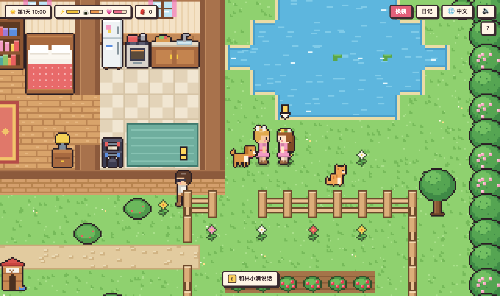
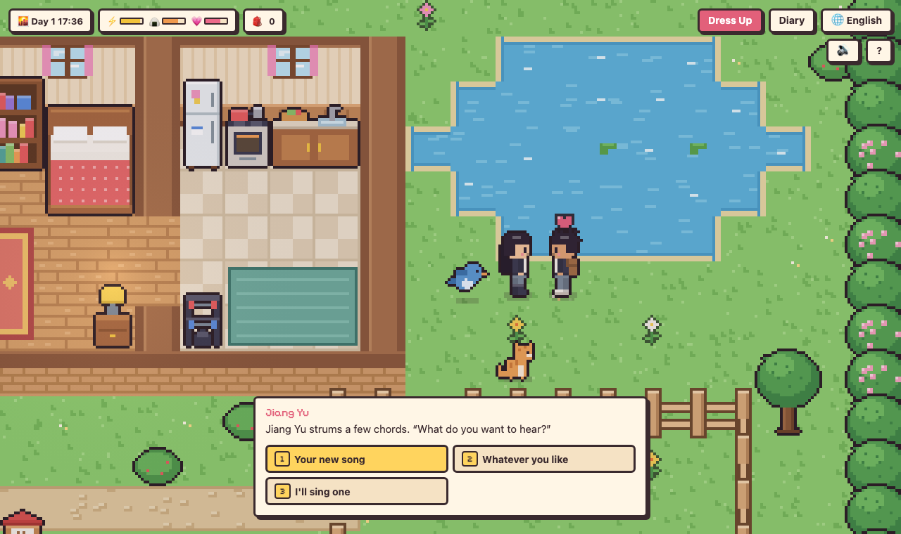
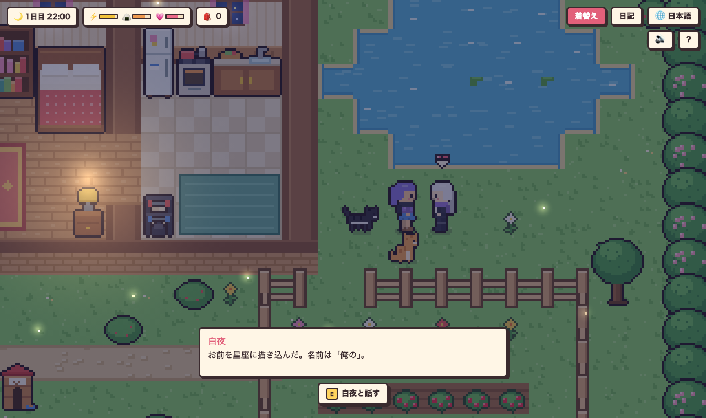
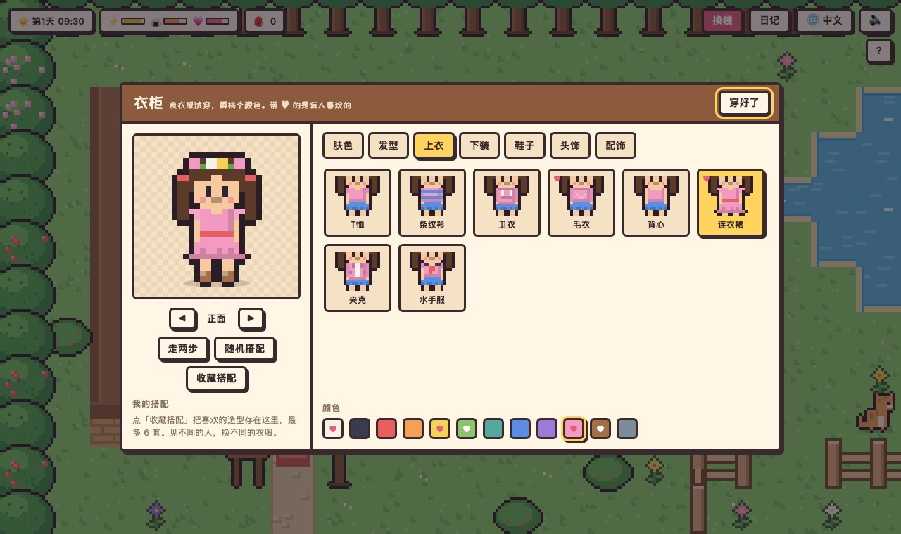
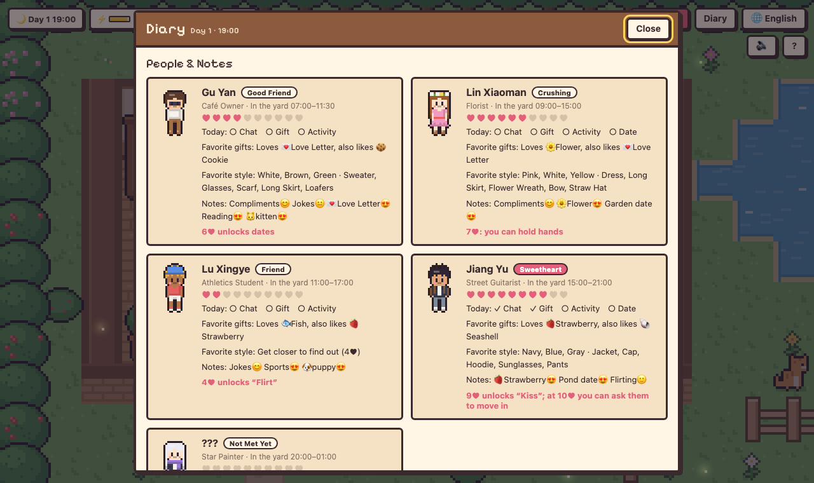
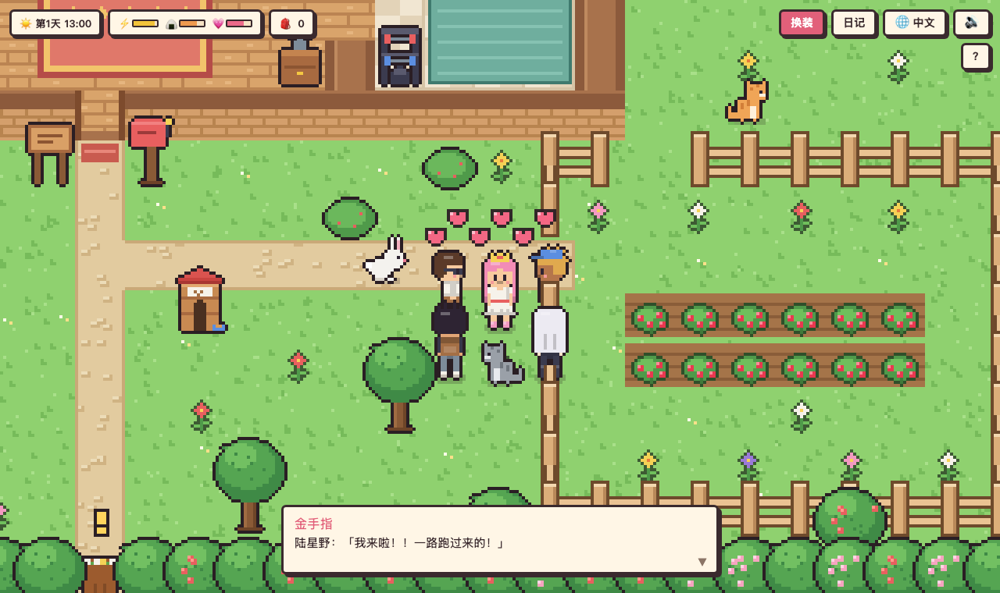
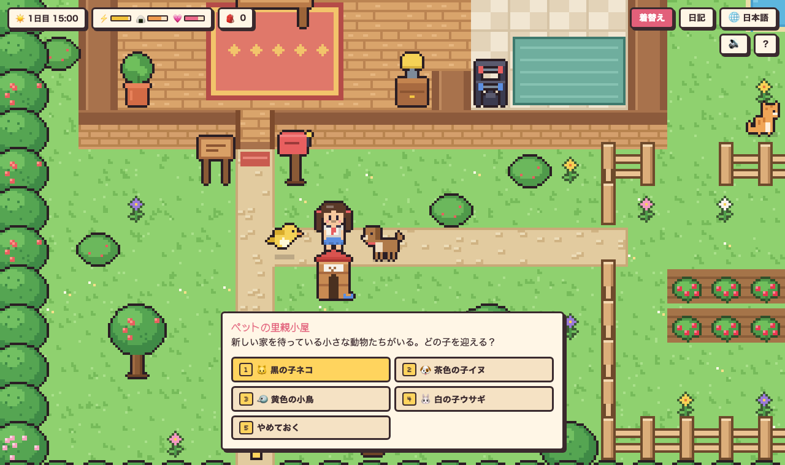
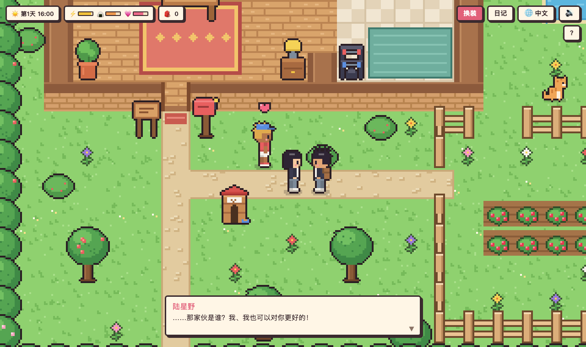
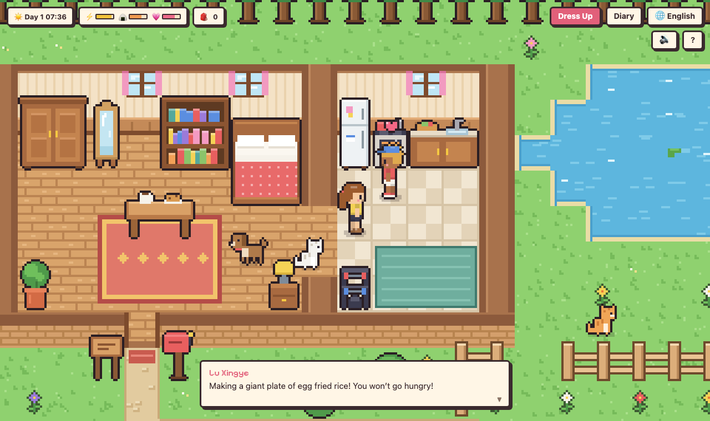
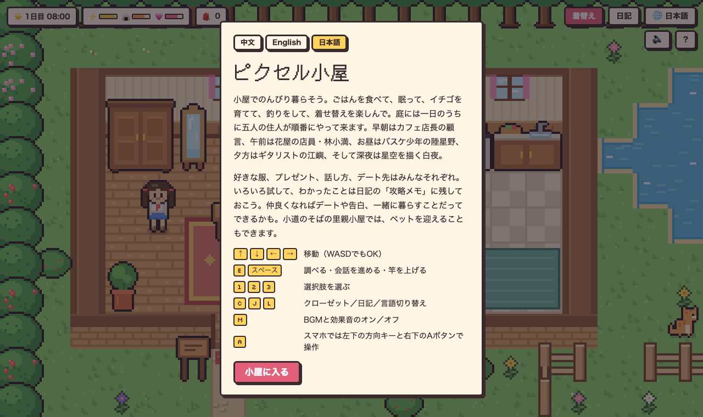

# 像素小屋 · Pixel Cottage · ピクセル小屋

一个像素风的「过日子 + 换装 + 恋爱」小游戏。整个游戏只有一个网页和三个语言文件，所有画面都由代码现场绘制，没有图片、模型或音频文件。

A cozy pixel-art life sim with dress-up and romance, playable in 中文 / English / 日本語. Every sprite is drawn by code; there are no image or audio files.

[中文](#中文) · [English](#english) · [日本語](#日本語) · [项目结构 / Project layout](#项目结构--project-layout)



## 截图 · Screenshots

| | |
|---|---|
|  |  |
| 约会和对话选项（English）<br>Dates and dialogue choices | 深夜和恋人白夜看星星（日本語）<br>Late night with Bai Ye |
|  |  |
| 衣柜，♥ 表示有人喜欢（中文）<br>The wardrobe; ♥ marks what someone likes | 日记里的关系和攻略笔记（English）<br>The diary: affection and notes |
|  |  |
| 金手指：所有男生好感全满，全都跑来找你（中文）<br>The Golden Charm brings every guy running | 在领养站领养宠物（日本語）<br>Adopting a pet at the hut |
|  |  |
| 修罗场：恋人吃醋了（中文）<br>Jealousy: caught by your partner | 同居生活：恋人在厨房做早饭（English）<br>Living together: breakfast in the new kitchen |



---

## 中文

### 游戏简介

你住在一间小屋里，屋外有池塘、菜园和花园。每天要吃饭、睡觉、换衣服，一天里会有五位居民轮流来院子里串门。和他们聊天、送礼物、一起做事、约会，好感够了就能告白，最后还能邀请对方搬进小屋一起住。

### 主要玩法

- **过日子**：时间会流逝（现实 1 秒 = 游戏 2 分钟），有白天、傍晚和夜晚。三条状态要照顾：⚡精力（去小床睡觉）、🍙饱腹（去小圆桌吃饭）、💗心情。熬到凌晨 2 点或精力耗光会直接睡着。
- **换装**：7 类衣物（肤色、发型、上衣、下装、鞋子、头饰、配饰），大部分有 12 种颜色，可以转身查看四个方向，可以随机搭配，最多收藏 6 套。在院子里采 3 朵花能解锁花环。
- **收集和制作**：采花，摘草莓，在小圆桌用草莓烤饼干，在书桌写情书，在池塘钓鱼（看到「！」立刻收竿，晚上更容易钓到稀有的星星石）。
- **恋爱和攻略**：
  - 每天可以和每个人聊天（有问答）、互动（夸奖、开玩笑、撩一下、牵手、拥抱、亲亲）、送礼物、一起做事（散步、钓鱼、看书、运动、看星星），以及约会（池塘、花园、星空野餐、在家做饭）。
  - 每个人吃的那一套都不一样：喜欢的颜色、衣服、礼物、话题、活动和约会地点各不相同。穿上对方喜欢的风格再去聊天，好感涨得更多。
  - 试过的东西会记进日记的「攻略笔记」，用 😍😊🙂😐😣 表示对方的反应。
  - 好感进度：2♥ 解锁一起做事，4♥ 撩一下，6♥ 约会，7♥ 牵手，8♥ 告白（心情要在 40 以上），恋人 9♥ 亲亲，10♥ 邀请同居。
  - 有了恋人还去撩别人、约别人，被恋人看到会吃醋扣好感（见下面的「修罗场」）。
- **宠物**：小路边的领养站可以领养小猫、小狗、小鸟、小兔（每种 3 种毛色，最多养 3 只），从候选名字里给它取名。宠物会跟着你走，也可以让它在原地等你。每天可以摸摸、喂它爱吃的东西、陪它玩；亲密度高了，早上会叼礼物回来。每位居民也有偏爱的小动物，带着对的宠物去聊天会额外加好感。
- **同居生活**：小屋扩建了，右边多了厨房（冰箱、灶台、台面）和健身角，卧室换成了双人床。好感满 10♥ 邀请恋人搬进来后，TA 会按时间表过日子：早上 7 点和傍晚 5 点半做饭（做好的饭放在小圆桌上，去吃就能回饱腹和心情），上午扫地，下午在健身角锻炼。TA 干活时可以过去帮忙，平时可以依偎在一起；晚上 9 点以后可以「今晚一起睡」，画面淡出，第二天早上会有专属的晨间对白。你自己也可以用灶台做菜、在健身角运动，恋人在家会一起帮忙。
- **金手指**：院子角落藏着一个闪闪发光的道具。用了以后，顾言、陆星野、江屿、白夜的好感度直接满格，当天还会全都跑来找你、跟着你转。捡到后可以马上用，也可以收进背包，之后在日记里点「使用」。
- **音乐和音效**：轻柔的八音盒背景音乐，晚上会变得更慢、更安静；走路、对话、采集、钓鱼、宠物叫声、好感上升都有音效。全部由浏览器现场合成，没有音频文件。按 M 或右上角 🔊 可以静音。

### 修罗场

有了恋人之后，如果当着恋人的面撩别人、牵别人的手、约别人出去，被看到就会吃醋，好感 -6。每个人吃醋的样子都不一样：

| 恋人 | 吃醋时说 |
|---|---|
| 顾言 | ……刚才那位，你们很熟吗？我只是好奇。 |
| 林小满 | ……刚才那个人是谁呀？我、我才没有在意呢。 |
| 陆星野 | ……那家伙是谁？我、我也可以对你更好的！ |
| 江屿 | ……刚才那人谁啊？我没生气，就是问问。 |
| 白夜 | ……你和那个人，聊得挺开心啊。 |


用了金手指之后，四位男生会同时围在你身边，修罗场就更热闹了。

### 五位居民

| 时间 | 角色 | 一句话 |
|---|---|---|
| 07:00–11:30 | 顾言 · 咖啡店店长 | 戴眼镜的温柔书生，吃撩不吃玩笑，最爱情书 |
| 09:00–15:00 | 林小满 · 花店店员 | 害羞又甜，最爱花，喜欢在花园约会 |
| 11:00–17:00 | 陆星野 · 体育系大学生 | 阳光直球，笑点超低，最爱鱼 |
| 15:00–21:00 | 江屿 · 街头吉他手 | 话少但温柔，最爱草莓，喜欢池塘 |
| 20:00–01:00 | 白夜 · 画星空的人 | 银发毒舌，夸他没用，最爱星星石 |

### 操作

| 按键 | 作用 |
|---|---|
| 方向键 / WASD | 走路 |
| E / 空格 | 互动、继续对话、钓鱼收竿 |
| 1 2 3 … | 选择对话选项 |
| C | 打开衣柜 |
| J | 打开日记 |
| L | 切换语言（也可以点右上角 🌐） |
| M | 打开或关闭音乐和音效（也可以点右上角 🔊） |

手机上会出现屏幕方向键和 A 键。

### 怎么玩

直接用浏览器打开 `index.html` 就能玩，不需要联网（联网时会加载像素字体）。也可以在本地起一个服务器：

```bash
python3 -m http.server 8000
```

然后打开 http://localhost:8000 。进度和语言选择都保存在浏览器里。

---

## English

### About

You live in a small cottage with a pond, a strawberry patch and a flower garden. Eat, sleep and dress up while five neighbors take turns visiting your yard through the day. Chat, give gifts, do things together and go on dates; with enough affection you can confess, and eventually invite one of them to move in.

### Features

- **Daily life**: time flows (1 real second = 2 game minutes) from morning to late night. Keep an eye on ⚡ energy (sleep in bed), 🍙 fullness (eat at the table) and 💗 mood. Stay up past 2 a.m. or run out of energy and you'll pass out.
- **Dress-up**: 7 categories (skin, hair, tops, bottoms, shoes, headwear, extras), most in 12 colors. Turn the preview to see all four sides, roll a random outfit, and save up to 6 looks. Pick 3 flowers to unlock the flower wreath.
- **Gathering and crafting**: pick flowers, harvest strawberries, bake cookies, write love letters at the desk, and fish at the pond (reel in the moment you see “!”; rare Star Stones bite more at night).
- **Romance**:
  - Each day you can chat (with questions), interact (compliment, joke, flirt, hold hands, hug, kiss), give a gift, do an activity together (walk, fish, read, sport, stargaze) and go on a date (pond, garden, starlit picnic, cooking at home).
  - Everyone has their own taste in colors, clothes, gifts, topics, activities and date spots. Dress the way they like before you chat and affection grows faster.
  - Whatever you try is recorded in the diary's Notes as 😍😊🙂😐😣.
  - Milestones: 2♥ activities, 4♥ flirt, 6♥ dates, 7♥ hold hands, 8♥ confess (mood 40+), 9♥ kiss as a couple, 10♥ move in together.
  - Flirt with someone else while your partner is watching and they'll get jealous (see Jealousy below).
- **Pets**: adopt a kitten, puppy, bird or bunny at the hut by the path (3 coat colors each, up to 3 pets) and pick a name. Pets follow you around or wait where you leave them. Pet, feed and play with them every day; with a strong bond they bring you presents in the morning. Each neighbor has a favorite animal, and chatting with the right pet nearby earns bonus affection.
- **Living together**: the cottage now has a kitchen (fridge, stove, counter), a workout corner and a double bed. Once your partner moves in (10♥), they follow a daily routine: cooking at 7:00 and 17:30 (the meal waits on the round table for fullness and mood), sweeping in the morning and working out in the afternoon. Help them with chores, cuddle up, and after 21:00 choose to spend the night together; the screen fades out and they greet you with their own good-morning line. You can also cook at the stove and work out yourself, and your partner pitches in.
- **Golden Charm**: something shiny is hidden in a corner of the yard. Use it and Gu Yan, Lu Xingye, Jiang Yu and Bai Ye all jump to max affection and come find you for the rest of the day. Use it on the spot or keep it in your bag and use it later from the diary.
- **Music and sound**: a soft music-box soundtrack that slows down and quiets at night, plus sounds for footsteps, dialogue, gathering, fishing, pets and rising affection. All of it is synthesized live in the browser; there are no audio files. Press M or the 🔊 button to mute.

### Jealousy

Once you have a partner, flirting with, holding hands with or dating someone else in front of them makes them jealous (affection -6). Everyone takes it differently:

| Partner | What they say |
|---|---|
| Gu Yan | …That person just now. Are you two close? Just curious. |
| Lin Xiaoman | …Who was that just now? N-not that I care or anything. |
| Lu Xingye | …Who was that? I-I can treat you way better! |
| Jiang Yu | …Who was that? I'm not mad. Just asking. |
| Bai Ye | …You and that person looked like you were having fun. |

### The neighbors

| Time | Who | In short |
|---|---|---|
| 07:00–11:30 | Gu Yan · café owner | Gentle bookworm in glasses; loves love letters, not jokes |
| 09:00–15:00 | Lin Xiaoman · florist | Shy and sweet; loves flowers and garden walks |
| 11:00–17:00 | Lu Xingye · athletics student | Sunny and direct; laughs at everything, loves fish |
| 15:00–21:00 | Jiang Yu · street guitarist | Few words, soft heart; loves strawberries and the pond |
| 20:00–01:00 | Bai Ye · star painter | Silver-haired and sharp-tongued; flattery fails, Star Stones win |

### Controls

Arrow keys or WASD to walk · E / Space to interact, continue and reel in · 1 2 3 to pick options · C wardrobe · J diary · L switch language (or the 🌐 button) · M music and sound on/off (or the 🔊 button). On phones, an on-screen pad and A button appear.

### Running it

Open `index.html` in a browser; it works offline (the pixel fonts load when online). Or serve the folder with `python3 -m http.server 8000` and visit http://localhost:8000. Progress and language are saved in the browser.

---

## 日本語

### ゲーム紹介

池とイチゴ畑と花壇のある小さな小屋で暮らすゲームです。ごはんを食べて、眠って、着替えて。一日のうちに 5 人の住人が時間ごとに庭へやって来ます。おしゃべりやプレゼント、一緒に遊んだりデートしたりして仲良くなれば告白でき、最後は小屋で一緒に暮らすこともできます。

### 主な遊び方

- **暮らし**：時間が流れます（現実の 1 秒 = ゲーム内 2 分）。⚡体力（ベッドで眠る）、🍙満腹（テーブルで食事）、💗気分の 3 つに気を配りましょう。深夜 2 時を過ぎるか体力が尽きると、その場で寝てしまいます。
- **着せ替え**：7 カテゴリ（肌の色、髪型、トップス、ボトムス、くつ、帽子・髪飾り、小物）、ほとんどが 12 色。4 方向から確認でき、ランダムコーデや最大 6 着までのお気に入り保存も。花を 3 本摘むと花かんむりが解放されます。
- **集める・作る**：花摘み、イチゴの収穫、クッキー作り、机でラブレターを書く、池で釣り（「！」が出たらすぐ竿を上げる。夜は珍しい星の石がかかりやすい）。
- **恋愛**：
  - 毎日、おしゃべり（質問つき）、ふれあい（褒める、冗談、ドキッとさせる、手をつなぐ、ハグ、キス）、プレゼント、一緒に過ごす（散歩、釣り、読書、運動、星空観察）、デート（池、花壇、星空ピクニック、おうち料理）ができます。
  - 好きな色、服、プレゼント、話題、遊び、デート先は人それぞれ。相手好みの服で話しかけると好感度が上がりやすくなります。
  - 試した反応は日記の「攻略メモ」に 😍😊🙂😐😣 で記録されます。
  - 目安：2♥ 一緒に過ごす、4♥ ドキッとさせる、6♥ デート、7♥ 手をつなぐ、8♥ 告白（気分 40 以上）、恋人で 9♥ キス、10♥ 同居。
  - 恋人の目の前で他の人を口説くと、やきもちを焼かれます（下の「修羅場」参照）。
- **ペット**：小道のそばの里親小屋で、子ネコ・子イヌ・小鳥・子ウサギを迎えられます（毛色は各 3 種類、3 匹まで）。名前は候補から選べます。ペットはあなたについて来るほか、その場で待たせることも。毎日なでて、好物をあげて、遊んであげましょう。なつき度が上がると朝にプレゼントを持ってきます。住人にはそれぞれ好きな動物がいて、その子を連れて話しかけると好感度にボーナスがつきます。
- **同居生活**：小屋が増築され、キッチン（冷蔵庫・コンロ・カウンター）とトレーニングコーナー、ダブルベッドができました。10♥ で恋人が引っ越してくると、毎日の時間割どおりに暮らします。朝 7 時と夕方 5 時半に料理（丸テーブルの手料理を食べると満腹と気分が回復）、午前は掃除、午後はトレーニング。家事を手伝ったり、寄り添ったり、21 時以降は「今夜は一緒に」を選ぶと画面が暗転し、翌朝その人だけのおはようの台詞が聞けます。自分でもコンロで料理、トレーニングコーナーで運動ができ、恋人が家にいれば一緒に手伝ってくれます。
- **ゴールデンチャーム**：庭の隅にキラキラ光るアイテムが隠れています。使うと顧言・陸星野・江嶼・白夜の好感度が一気に最大になり、その日はみんながあなたに会いに来て、ずっとそばにいてくれます。拾ってすぐ使っても、カバンにしまって後から日記で「使う」を押してもOK。
- **BGMと効果音**：やさしいオルゴールのBGM（夜はゆっくり静かに）と、足音・会話・採集・釣り・ペットの鳴き声・好感度アップなどの効果音。すべてブラウザでその場で合成していて、音声ファイルはありません。M キーか右上の 🔊 でミュートできます。

### 修羅場

恋人ができたあと、恋人の目の前で他の人を口説いたり、手をつないだり、デートに誘ったりすると、やきもちを焼かれて好感度 -6。やきもちの焼き方は人それぞれ：

| 恋人 | やきもちの台詞 |
|---|---|
| 顧言 | ……さっきの人とは、仲がいいんですか？ ただ気になっただけですよ。 |
| 林小満 | ……さっきの人、誰？ べ、別に気にしてないもん。 |
| 陸星野 | ……あいつ誰だよ？ お、俺だって、お前にもっと優しくできるし！ |
| 江嶼 | ……さっきのやつ誰だ？ 怒ってない。聞いただけ。 |
| 白夜 | ……あいつとは、ずいぶん楽しそうに話してたな。 |

### 住人たち

| 時間 | 住人 | ひとこと |
|---|---|---|
| 07:00–11:30 | 顧言・カフェ店長 | 眼鏡の穏やかな読書家。冗談より口説き文句、ラブレターが一番 |
| 09:00–15:00 | 林小満・花屋の店員 | 恥ずかしがり屋で甘い。花と花壇デートが好き |
| 11:00–17:00 | 陸星野・体育会系大学生 | まっすぐで明るい。笑いのツボが浅く、魚が大好き |
| 15:00–21:00 | 江嶼・ストリートギタリスト | 口数は少ないけど優しい。イチゴと池が好き |
| 20:00–01:00 | 白夜・星空を描く人 | 銀髪で毒舌。お世辞は効かない、星の石が一番 |

### 操作

矢印キー / WASD で移動 · E / スペースで調べる・会話を進める・竿を上げる · 1 2 3 で選択 · C クローゼット · J 日記 · L 言語切り替え（右上の 🌐 でも可） · M BGMと効果音のオン／オフ（右上の 🔊 でも可）。スマホでは画面の十字キーと A ボタンを使います。

### 遊び方

`index.html` をブラウザで開くだけで遊べます（オフライン可。オンライン時はピクセルフォントを読み込みます）。`python3 -m http.server 8000` で起動して http://localhost:8000 を開いても OK。進行状況と言語はブラウザに保存されます。

---

## 项目结构 / Project layout

| Path | 内容 / What it is |
|---|---|
| `index.html` | 游戏本体：绘图、地图、角色、各种系统 / The whole game: drawing, map, characters, systems |
| `lang/zh.js` | 简体中文文本（源语言）/ Simplified Chinese text (source) |
| `lang/en.js` | 英文文本 / English text |
| `lang/ja.js` | 日文文本 / Japanese text |
| `tools/check-lang.js` | 检查语言包和 `zh.js` 是否一致 / Checks a language pack against `zh.js` |
| `docs/screenshots/` | README 里的截图 / Screenshots used in this README |

### 修改或添加语言 / Editing or adding a language

所有玩家能看到的文字都在 `lang/<code>.js` 里。要加一种新语言：复制 `lang/zh.js`，只翻译值、不要改键名，保留所有 `{占位符}`，数组长度保持一致；然后在 `index.html` 里加一个 `<script>` 标签，把语言代码加进 `LANG_ORDER`，最后运行检查：

All player-facing text lives in `lang/<code>.js`. To add a language, copy `lang/zh.js`, translate the values (never the keys), keep every `{placeholder}` and keep arrays the same length. Add a `<script>` tag in `index.html`, add the code to `LANG_ORDER`, then run:

```bash
node tools/check-lang.js <code>
```
